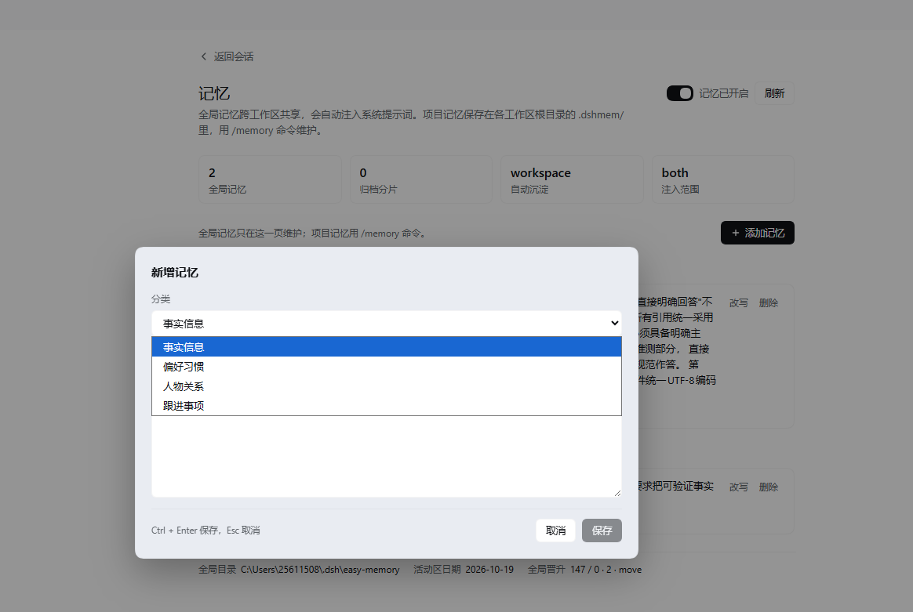

# dsh-easy-memory

> 给 [DeepSeek Harness](https://github.com/deepseek-ai/deepseek-harness) 的 Agent 装一份长期记忆：**一份跨工作区的用户全局记忆** + **每个工作区根目录 `.dshmem/` 下的项目记忆**。记忆会自动注入、自动沉淀、自动归档、自动晋升。

中文 | [English](README.en.md)

---

## 目录

- [这是什么](#这是什么)
- [特性](#特性)
- [它是怎么工作的](#它是怎么工作的)
- [安装](#安装)
- [快速验证](#快速验证)
- [使用](#使用)
- [记忆存放在哪](#记忆存放在哪)
- [配置](#配置)
- [常见问题](#常见问题)
- [已知限制](#已知限制)
- [开发与测试](#开发与测试)
- [兼容性](#兼容性)
- [许可](#许可)

---

## 这是什么

Agent 每次开新会话都从零开始，你反复告诉它同样的事：用 pnpm 不用 npm、提交信息写中文、这个项目统一两空格缩进。`dsh-easy-memory` 把这些话沉淀成结构化记忆，并在之后的每一次请求里自动带上。

四类抽取范围（事实信息 / 偏好习惯 / 人物关系 / 跟进事项）、注入系统提示词、主页侧栏「记忆」面板里可视化查看与增删改、一键开关、从其他 AI 导入、分片归档与跨工作区晋升。

整个插件**只依赖 Node 内置模块**，不导入任何 `@deepseek-ai/*` 包，因此不会因为宿主目录的模块解析策略变化而失效。

---

## 特性

| 特性 | 说明 |
|---|---|
| 自动注入 | 每次组装提示词时，把用户全局记忆与当前工作区的项目记忆一并注入 |
| 自动沉淀 | 每一轮对话结束后，用会话自己的模型抽取值得长期保留的信息，写进项目记忆 |
| 分片归档 | 活动区跨天或超出容量上限时，旧条目自动切进 `shards/`，主索引常驻、分片按需召回 |
| 全局晋升 | 同一条记忆在多个不同工作区重复出现时，自动升级为用户全局记忆 |
| 可视化面板 | 主页侧栏「记忆」：开关、按分类添加、就地改写、删除、查看归档与晋升统计 |
| 两套接口 | 模型用 `memory_*` 四个工具，人用 `/memory` 斜杠命令或侧栏记忆面板 |
| 对话留痕 | 每轮对话摘要追加到 `.dshmem/journal/<日期>.md`，作为原始素材 |
| 数据可读 | 权威数据是 JSON，同时生成人类可读的 `memory.md` 视图 |
| 零依赖 | 只用 `node:fs` / `node:path` / `node:crypto` / `node:os` |

---

## 它是怎么工作的

```
                     ┌──────────────── 用户全局记忆 ────────────────┐
                     │  <DSH_HOME>/easy-memory/memory.json          │
                     │  memory.md · state.json · promotion.json      │
                     │  shards/                                      │
                     └───────────────▲──────────────────────────────┘
                                     │ 晋升：同一文本出现在 ≥2 个工作区
                                     │
   一轮对话 ──► turn/end ──► 抽取 ───┘
        │                    │
        │                    └──► 项目记忆  <workspace>/.dshmem/memory.json
        │                                   memory.md · shards/
        └──► journal/<日期>.md
                                    
   下一次请求 ──► system-prompt section ──► 全局记忆 + 项目记忆 + 用法说明
```

三个关键机制：

**注入。** 插件注册一个名为 `easy-memory` 的 system-prompt section。根上下文那条只带全局记忆；`agent/created` 时再在 agent 作用域注册一条**同名** section，按 Harness 的作用域遮蔽规则覆盖它，并带上该 agent 工作目录的项目记忆。注册前会先把这个 agent 要用的记忆读进缓存，所以**重启后的第一次请求也能看到记忆**。

**沉淀。** `turn/end` 到达时，插件取该轮对话文本，用**会话自己刚才用的 provider/model** 发一次模型调用，要求只回一个 JSON 数组，再把解析出的条目写进项目记忆。同一时刻只跑一次，有超时，太短就跳过。

**归档与晋升。** 每次写入前检查活动区是否跨天、超条数、超字节；命中就按更新时间倒序，保留最近一批，其余写进分片。写入项目记忆时同步登记晋升账本，同一条文本在多个工作区出现就晋升为全局记忆。

---

## 安装

插件通过 DeepSeek Harness 的 bundle 机制安装。把本仓库放到任意目录，然后在 Harness 会话里让 Agent 执行：

```
plugin_manager(action: "install_bundle", target: "<本仓库的绝对路径>")
```

或者用命令行（需要该安装提供 `dsh` 可执行文件）：

```
dsh plugin --profile <profile> add <本仓库的绝对路径>
```

安装会更新 profile 的依赖、选中该 bundle，并应用包内的 `cordis.patch.yml`。**装完要重启 Harness 进程**，Host 半与 Client 半才会加载。

卸载：

```
plugin_manager(action: "remove_bundle", target: "dsh-easy-memory")
```

记忆数据不会被删除，`<DSH_HOME>/easy-memory/` 与各工作区的 `.dshmem/` 都还在。

---

## 快速验证

装好并重启之后：

1. **看状态。** 输入 `/memory path`，应当打印出全局目录、项目目录、状态文件与记忆面板入口。
2. **看注入。** 让 Agent 做任意一件事，它这一轮的系统提示词里应当出现 `## Long-term memory (dsh-easy-memory)` 段落。
3. **写一条。** 输入 `/memory add --kind preference 我习惯用 pnpm 而不是 npm`，应当返回"已记录到 …/.dshmem"。
4. **验自动。** 新开一轮，问 Agent"我习惯用什么包管理器？"。它应当先调 `memory_search` 再回答。
5. **看侧栏。** 主页左侧应当多出「记忆」一行，位置在 Skill/MCP 与自动化任务之间；点开是独立的整页记忆面板。

---

## 使用

### 自动发生的四件事

你什么都不用做，插件自己会：

1. 每次组装请求时注入记忆；
2. 每轮对话结束后抽取新记忆（写入项目记忆）；
3. 每轮对话摘要写进 `.dshmem/journal/`；
4. 跨天或超容量时归档，跨工作区复现时晋升。

### 模型工具

| 工具 | 作用 |
|---|---|
| `memory_write` | 写入一条记忆。参数 `scope`（`global` / `workspace`）、`kind`、`text`、可选 `tags` |
| `memory_search` | 按关键词检索活动区与归档分片。空格分隔的词都要命中；不给 `query` 就是列出最近条目 |
| `memory_forget` | 删除记忆。必须给 `id` 或 `query` 之一 |
| `memory_status` | 报告目录、活动区条数、分片数、开关与晋升统计 |

### `/memory` 命令

| 命令 | 作用 |
|---|---|
| `/memory show` | 查看全局与项目记忆 |
| `/memory add <文本>` | 写入项目记忆（默认 `fact`） |
| `/memory add --global <文本>` | 写入全局记忆 |
| `/memory add --kind preference <文本>` | 指定分类 |
| `/memory forget <id\|关键词>` | 删除匹配的记忆 |
| `/memory forget --global <关键词>` | 只删全局记忆 |
| `/memory edit <id> <新文本>` | 就地改写一条记忆 |
| `/memory promote <id>` | 把一条项目记忆手动晋升为全局记忆 |
| `/memory promotions` | 查看晋升账本（候选与已晋升） |
| `/memory distill` | 立即对最后一轮对话做一次沉淀 |
| `/memory shards` | 列出两边的归档分片 |
| `/memory import <多行文本>` | 逐行导入全局记忆 |
| `/memory on` / `/memory off` | 开关记忆 |
| `/memory path` | 显示各存储目录 |
| `/memory help` | 帮助 |

### 记忆面板

主页侧栏 → **记忆**（在 Skill/MCP 与自动化任务之间），提供：

- 记忆总开关（写入 `state.json`，与 `/memory off` 同一个开关）；
- 顶部四格概况：全局条数、归档分片数、自动沉淀模式、注入范围；
- 「添加记忆」按钮弹出大输入框：分类 + 多行内容，`Ctrl + Enter` 保存、`Esc` 取消；
- 每条记忆的**改写**与**删除**（改写走同一个弹窗；删除需点两次确认）；
- 底部信息：全局目录、活动区日期、晋升统计。

这一页只管理**全局记忆**：面板是 root 作用域、拿不到具体会话，所以它不知道你在哪个工作区。项目记忆请用 `/memory` 或 `memory_*` 工具。

数据通路是插件自己注册的同源 HTTP 路由，挂在 `/dsh-easy-memory/*` 下：`summary`、`toggle`、`add`、`update`、`delete`。

---

## 记忆存放在哪

**用户全局记忆**（跟人走，跨工作区共享）：

```
<DSH_HOME>/easy-memory/
    memory.json       主索引（权威数据）
    memory.md         自动生成的只读视图
    state.json        记忆开关
    promotion.json    全局晋升账本（跨工作区共享）
    shards/           归档分片
```

**项目记忆**（跟项目走）：

```
<workspace>/.dshmem/
    memory.json       主索引（权威数据）
    memory.md         只读视图
    shards/2026-10-13-1.json    归档分片
    journal/2026-10-14.md       每轮对话摘要
```

`memory.json` 是唯一权威来源；`memory.md` 每次写入后重新生成，**手工改它不会被读回**。

主索引形状：

```json
{
  "version": 2,
  "updatedAt": 1760000000000,
  "activeDate": "2026-10-14",
  "entries": [ /* 当前活动区的条目 */ ],
  "shards": [
    { "file": "shards/2026-10-13-1.json", "date": "2026-10-13", "count": 42, "createdAt": 1760000000000 }
  ]
}
```

单条记忆：

```json
{
  "id": "m-mv7j2u2j-8c895020",
  "kind": "preference",
  "text": "用户偏好中文回答，技术术语保留英文原词。",
  "tags": [],
  "createdAt": 1760000000000,
  "updatedAt": 1760000000000,
  "hits": 1,
  "source": { "sessionId": "session-...", "at": 1760000000000 }
}
```

同一条文本在同一分类下重复写入不会叠加，而是更新 `updatedAt` 并让 `hits` 加一。

---

## 配置

配置写在 `cordis.patch.yml` 的 `config` 段。随包分发的那份带注释列全了所有键，全部可省略：

| 键 | 默认 | 含义 |
|---|---|---|
| `enabled` | `true` | 总开关 |
| `scope` | `both` | 注入范围：`both` / `global` / `workspace` |
| `globalDir` | 空 | 全局记忆目录；空表示 `<DSH_HOME>/easy-memory` |
| `workspaceDirName` | `.dshmem` | 工作区记忆目录名 |
| `sectionOrder` | `500` | section 排序值 |
| `maxEntriesInPrompt` | `40` | 每个作用域最多注入多少条 |
| `maxInjectChars` | `4000` | 注入文本总字符上限 |
| `maxTextChars` | `500` | 单条记忆在提示词里的字符上限 |
| `refreshMs` | `15000` | 重读磁盘与检查跨天归档的间隔（毫秒） |
| `journal` | `true` | 是否写 `.dshmem/journal/` |
| `journalMaxChars` | `1200` | journal 每条消息的截断长度 |
| `shardMaxEntries` | `200` | 活动区超过这么多条就归档 |
| `shardMaxBytes` | `131072` | 活动区序列化超过这么多字节就归档 |
| `keepActiveEntries` | `50` | 归档时主索引保留最近多少条 |
| `searchShards` | `10` | 检索最多读多少个最近分片 |
| `autoDistill` | `workspace` | 自动沉淀写到哪：`workspace` / `global` / `both` / `off` |
| `distillMinChars` | `200` | 该轮对话短于此长度就跳过沉淀 |
| `distillMaxInputChars` | `12000` | 送给模型的对话文本上限 |
| `distillMaxEntries` | `8` | 单轮最多沉淀多少条 |
| `distillTimeoutMs` | `60000` | 单次沉淀超时 |
| `promoteEnabled` | `true` | 全局晋升开关 |
| `promoteAfterWorkspaces` | `2` | 同一文本在几个不同工作区出现过才晋升 |
| `promoteMode` | `move` | `move` 搬进全局并从所有工作区移除；`copy` 两边各留一份 |
| `promotionLedgerMax` | `2000` | 晋升账本最多保留多少条候选，超出按「已晋升优先、其次最近」裁剪 |

例如只注入全局记忆、并关掉自动沉淀：

```yaml
- insert:
    - id: dsh-easy-memory
      name: dsh-easy-memory
      config:
        scope: global
        autoDistill: off
```

---

## 常见问题

**工作区记忆必须用 `/memory` 命令才能用吗？它不会自己去读吗？**

会自己读。记忆在**每次组装系统提示词时自动注入**，`/memory` 只是给你自己查看和手工维护用的。你可以这样确认：让 Agent 随便做点事，看它那一轮的系统提示词里有没有 `## Long-term memory (dsh-easy-memory)` 段落，以及里面有没有 `### Project memory (workspace: …)`。模型侧的 `memory_search` 也是自动可用的工具，不需要你先敲命令。

**它会自己往里写吗？**

会。每一轮对话结束（`turn/end`）后，插件用会话当前使用的模型跑一次抽取，把值得长期保留的信息写进**项目记忆**。你可以用 `autoDistill: off` 关掉，或者用 `/memory distill` 手动触发。

**自动沉淀要花钱吗？**

要。它是真实的一次模型调用，走你会话正在用的 provider 与 model，因此有 token 成本与延迟。想省掉就设 `autoDistill: off`，改由你在对话里显式说"记住这件事"。

**"进化到全局"是怎么判断的？**

插件的判据是：**同一条记忆文本在多个不同工作区里都出现过**。理由是只属于某个项目的信息不会被写进别的项目。阈值由 `promoteAfterWorkspaces` 控制（默认 2）。你也可以用 `/memory promote <id>` 手动晋升。

**我只在一个工作区干活，会自动晋升吗？**

不会——跨工作区复现的前提不成立。这种情况请用 `/memory promote <id>` 手动晋升。

**记忆会不会过期？**

条目不会自动过期。它们会随分片归档退居二线，但 `memory_search` 仍然能搜到。想清掉就用 `memory_forget` 或 `/memory forget`。

**它能和别的记忆类插件共存吗？**

可以，但要避免两者都往系统提示词里塞同类内容。本插件的 section 名固定为 `easy-memory`，工具名固定为 `memory_*`。

## 开发与测试

Host 半是纯 ESM，按职责拆在 `lib/` 下，没有构建步骤；Client 半仍然是单个手写文件
`client.js`（浏览器侧每个插件只能加载一个文件）。改完 Host 或 Client 文件后重启
Harness 即可生效（profile 记录的是目录链接）；Client 侧在页面刷新后生效。

```bash
npm run check   # 语法检查
npm test        # 两个冒烟测试：Host 装配 + Client bundle 接线
```

```
index.js             Host 入口：配置、section、事件接线与注册
lib/constants.js     常量、枚举与默认配置
lib/util.js          日志、文本、原子读写、串行锁
lib/config.js        配置归一化
lib/store.js         主索引 + 分片 + 归档
lib/search.js        主索引与分片检索
lib/prompt.js        系统提示词渲染
lib/entry.js         条目视图与参数校验
lib/promotion.js     跨工作区晋升账本
lib/tools.js         memory_* 四个工具
lib/commands.js      /memory 命令
lib/turn.js          journal 与自动沉淀
lib/http.js          记忆面板 HTTP 接口
client.js            Client 半：侧栏「记忆」入口与整页面板（单文件，无构建）
tests/*.mjs          两个冒烟测试
cordis.patch.yml     随包分发的 profile patch（带全部配置项注释）
package.json         bundle 清单
locale/*.json        插件管理器里的标题与描述
icon.svg             自绘图标
```

> 注意：存储层的写入走 `node:fs`，所以任何测试都必须传入临时的 `globalDir` 与
> 临时工作区，否则会写到真实的记忆目录里（`tests/apply-smoke.mjs` 就是这么做的）。

---

## 兼容性

- 开发与验证基于 **DeepSeek Harness 0.2.1**。
- Host 半依赖 `tools`、`systemPrompt`、`commands`、`workingDirectory` 四个服务存在；`webServer` 与 `llm` 是可选获取，缺失时只是少掉记忆面板或自动沉淀，其余功能不受影响。